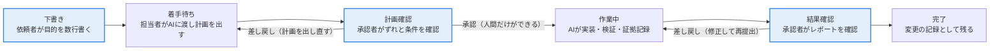
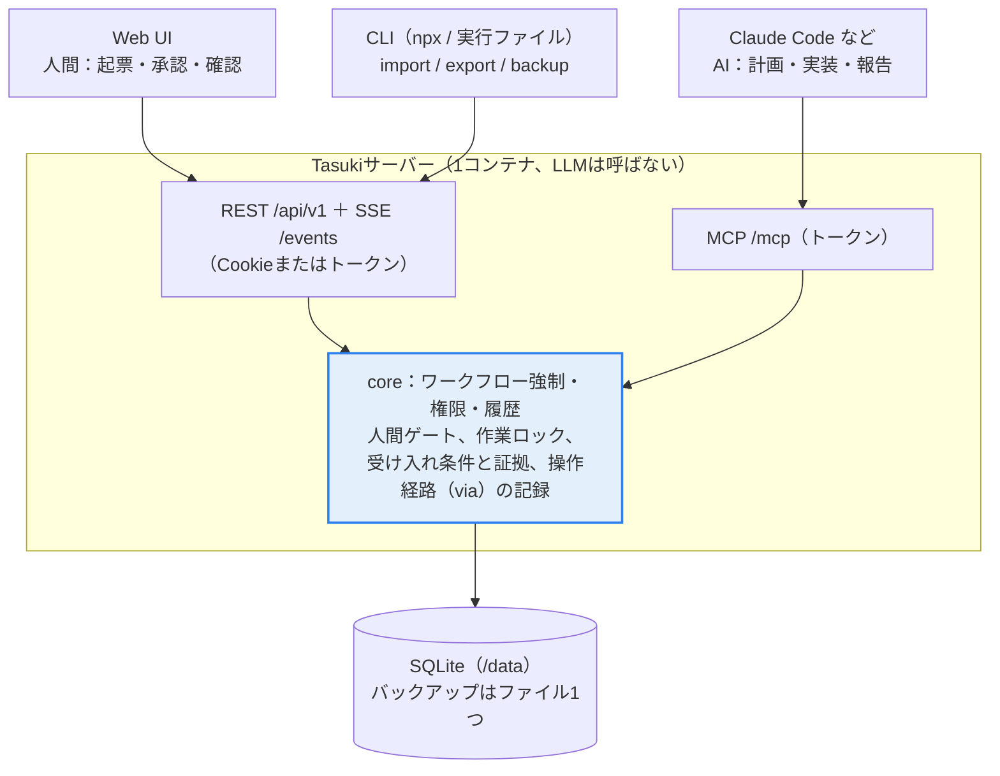
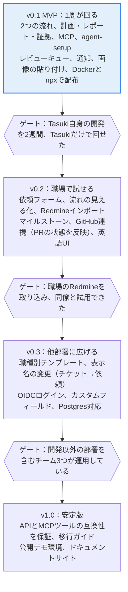

# Tasuki 設計書

2026-11-26 · suzukitech

## 概要と目的

Tasukiは、**AIが実装と検証を担う前提で作る、チケット駆動開発（TiDD）のためのチーム向けチケット管理ツール**です。ライセンスはMITです。チケットはAIに渡す長めの依頼書であり、人間の仕事は「何を作るかを書く」「AIとの認識のずれを潰す」「何が実装されたかを確かめる」の3つに絞ります。

- **解決したい課題**: RedmineもJiraも「人間が実装する」前提で作られている。AIに渡すには情報が足りず、AIが何をしたかもチケットに残らない。RedmineはMCP連携も難しい。
- **対象**: Claude Codeなどのコーディングエージェントで開発する2〜50人のチーム。PMやデザイナーもWeb UIだけで起票と確認ができること。
- **ゴール**: 「起票→AIが計画→人間が承認→AIが実装・検証→人間がレポートを確認」の1周が、TasukiとClaude Codeだけで回るv0.1を出す。セットアップは5分。
- **Tasuki自身はLLMを呼ばない**: AIはMCP経由で接続してくる側。サーバーにAPIキーが不要で、運用コストはゼロのまま。
- **この文書の位置づけ**: Claude Codeで実装するための設計書。リポジトリの `docs/DESIGN.md` に置く。

## 位置づけ

コンセプトは「Redmineを、AIネイティブに。」です。古いUIを一新し、AIに仕事を渡して結果を確かめる流れを、自分たちのサーバーで無料で回せるようにします。

|            | Redmine      | Linear                                       | Backlog.md             | Tasuki                             |
| ---------- | ------------ | -------------------------------------------- | ---------------------- | ---------------------------------- |
| 費用       | 無料         | 有料（AI機能は上位プランも）                 | 無料（MIT）            | 無料（MIT）                        |
| 置き場所   | 自社サーバー | クラウドのみ                                 | リポジトリ内のファイル | 自社サーバー（コンテナ1つ）        |
| 使う人     | 開発者以外も | 開発チーム                                   | Gitを使う開発者        | 開発者とPM・デザイナー             |
| AIとの連携 | 弱い         | 課題をエージェントに割り当て、クラウドで実行 | MCPとCLI               | MCP。自分たちのClaude Code等で実行 |
| 人間の確認 | なし         | PRレビュー                                   | 運用で守る             | 計画承認と結果確認をサーバーが強制 |
| 移行       | —            | Jira等から                                   | —                      | Redmineからそのまま取り込める      |

Linearは[クラウドのコーディングエージェント](https://linear.app/docs/linear-cloud-coding-agent)で、課題からPRを作れます。[Backlog.md](https://github.com/MrLesk/Backlog.md)は、受け入れ条件、計画、最終報告をMarkdownファイルで回す仕組みを先に実現しています。Tasukiが絞るのは、このどちらも届かない「Redmineを自社サーバーで使っている日本のチーム」です。Backlog.mdからは、タスクを小さく切ってからAIに渡すという考え方を取り入れます。

**技術職から始め、他の職種への入口は最初から開けておきます。** 依頼→計画→実行→結果確認という流れは、職種を選びません。実行するのがClaude Codeなら開発、Claudeのデスクトップアプリなら資料作り、人なら事務作業になるだけです。そこで、データの構造とワークフローは汎用のまま作り、最初の機能と宣伝は技術チームに絞ります。

- **v0.1から**: 営業やCSなど他の職種の人は、「依頼者」と「承認者」として参加できる。コードを見ずに、レポートで結果を確かめられる。アカウントなしで使える依頼フォームはv0.2で入れる。
- **v0.3以降**: 職種別のテンプレートと、表示名の変更（「チケット」を「依頼」と呼ぶなど）を入れ、他部署の仕事そのものを載せられるようにする。
- **作らないもの**: ポートフォリオ、ガント、作業量管理、自由に組めるワークフロー。Asanaと機能の量で競うと、Redmineと同じ重さに戻るため。

**Tasukiの見える化は「誰が何をしているか」ではなく、「どこで流れが止まっているか」です。** AIで実行が速くなるほど、人の確認待ちが全体の速さを決めるようになるからです。

## 名前の候補

名前は **Tasuki（襷）** です。駅伝のたすきのように、人と人、人とAIの間で仕事を引き継ぐという意味で、チーム前提とMCP前提の両方に合います。他の候補は参考として残します。

| 候補              | 意味                   | 良い点                                            | 気になる点                       |
| ----------------- | ---------------------- | ------------------------------------------------- | -------------------------------- |
| Tasuki（襷）      | 駅伝のたすき、引き継ぎ | 人⇔AIのハンドオフを表せる。英語圈でも発音しやすい | 海外では意味が伝わらない         |
| Fuda（札）        | 札、チケットそのもの   | 4文字でCLI名に向く（`fuda new`）                  | 地味。既存の小規模OSSがあるかも  |
| Daicho（台帳）    | 記録の元帳             | 「チームの台帳」として意味が明確                  | 硬い印象。開発ツールらしさは弱い |
| Kumi（組）        | チーム、組             | チーム前提が伝わる。短い                          | 一般的な単語で検索に埋もれる     |
| Tsumiki（積み木） | バックログを積む       | 親しみやすく、可愛いロゴが作れる                  | 同名のOSSやサービスが多そう      |
| Noren（暖簾）     | 気軽にくぐれる入口     | 「導入が簡単」を表せる                            | チケット管理とのつながりが遠い   |
| Bento             | 区切って整理する       | 海外でも通じる                                    | 同名の製品が非常に多い           |

**名前はTasukiに決定しました。** ただし、npmの `tasuki` は、AI開発向けのマルチエージェント基盤がすでに使っています（2026-11-26に確認）。GitHubの `tasuki` というユーザー名も、囲碁のサイトが使っています。そこで次のようにします。

- 製品名は Tasuki。
- リポジトリは `<GitHubユーザー名>/tasuki`。
- npmはスコープ付きの `@<GitHubユーザー名>/tasuki`（公開なら無料）。実行は `npx @<ユーザー名>/tasuki serve`。
- 同じAI開発の分野で名前が重なるため、READMEの1行目で「Redmineに代わる、AIネイティブなチケット管理」だとはっきり書く。

## 設計方針

チーム前提にしたため、**正本はMarkdownファイルではなくサーバー上のSQLite**に変えました。ファイルベースだと、Gitを使わないメンバーが参加できず、連番IDも衝突するからです。Markdownは本文の書式と、エクスポート形式として残します。

1. **必須はタイトルだけ**: 担当者、優先度、期日などはすべて任意。Redmineの「入力しないと保存できない」をなくす。
2. **1画面で完結**: 一覧やボードから画面遷移せず、サイドパネルで編集する。
3. **キーボード優先**: `C` で作成、`Cmd+K` でコマンドパレット。Linearに近い操作感。
4. **人とAIは同じAPIを使う**: Web UI、CLI、MCPはすべて同じサービス層を通る。AIの操作も人の操作も、同じ権限チェックと履歴に残る。
5. **AIの操作は必ず履歴で区別できる**: 「suzukiがClaude Code経由で変更」と表示する。チームでAIを使うときの信頼の土台になる。
6. **セットアップは単一コンテナ**: 外部DB、Redis、メールサーバーを必須にしない。バックアップはSQLiteファイルのコピーで済む。
7. **機能を増やしすぎない**: ガント、工数管理、ワークフローエンジンは作らない。必要ならOpenProjectを使ってもらう。

## TiDD×AIのワークフロー

1枚のチケットは、**人間の確認ゲート2つ**を挟んでAIの作業が進む一本道です。ゲートは「計画の承認（認識合わせ）」と「実装レポートの確認」で、どちらも差し戻せます。



青枠は人間が動く段階、白枠はAIが動く段階です。

人間の番は「書く」「計画を承認する」「レポートを確認する」の3回だけで、その間はすべてAIが進めます。どの段階でも、AIは質問を投稿して人間の回答を待てます。

**役割**（少人数のチームでは1人が兼ねてよい）

| 役割   | やること                                                                                             |
| ------ | ---------------------------------------------------------------------------------------------------- |
| 依頼者 | 何を作りたいかを書く。既定ではこの人が承認者になる                                                   |
| 担当者 | 自分のPCのClaude CodeなどでAIを動かす。AIはこの人の権限で作業する                                    |
| 承認者 | 計画を承認し、結果を確認する。「要求を満たしたか」を見る人で、コードの品質はGitHubのPRレビューで見る |

**AIに任せるチケットの流れ**

| 状態     | 誰の番     | やること                                                             | 次へ進む条件         |
| -------- | ---------- | -------------------------------------------------------------------- | -------------------- |
| 下書き   | 依頼者     | タイトルと目的を数行書く。受け入れ条件は任意                         | 担当者が決まった     |
| 着手待ち | 担当者とAI | 担当者がAIに渡す。AIはコードを調べ、計画と受け入れ条件の案を提出する | 計画が提出された     |
| 計画確認 | 承認者     | AIの理解と計画を確認し、受け入れ条件を直して承認する                 | 承認された           |
| 作業中   | 担当者とAI | AIが実装し、テストし、条件ごとに証拠を記録する                       | レポートが提出された |
| 結果確認 | 承認者     | レポートを読み、要求を満たしたかを判断する                           | 完了にした           |
| 完了     | —          | チケットがそのまま変更の記録になる                                   | —                    |

**シンプルなチケットの流れ**: 未着手→進行中→完了の3段階です。問い合わせ、事務作業、人間が手でやる作業に使います。作成画面の「AIに任せる」スイッチで切り替え、途中で切り替えることもできます（シンプル→AIはいつでも。AI→シンプルは未着手・進行中・完了のときだけで、計画確認・結果確認中は切り替えられません）。

- **AIは完了にも承認にもできない**。この2つは、ブラウザでログインした人間だけができる。
- どのチケットにも「あなたの番」「AIの番」「他の人の番」のバッジを出す。自分の番になったら通知する。
- 小さなチケットは計画確認を省略できる（チケットごとの「計画確認なし」チェックと、種別ごとの既定値）。結果確認は省略できない。
- 承認後に受け入れ条件を変えると、どの状態でも計画の承認は取り消される。作業中・結果確認なら、同じ計画が「提出済み」に戻って計画確認に戻り、承認者が新しい条件で見直す（結果確認からの場合、提出済みのレポートは差し戻し扱いになる）。それ以外の状態（着手前など）では計画は「破棄」になり、新しい計画を出し直す。
- AIが詰まったら質問を投稿して「質問中」になる。回答されると担当者に通知が届き、AIが再開できる。
- 状態の名前は変えられるが、流れは固定。Redmineのような自由なワークフロー編集は作らない。

## チケットの構造

チケットは「AIへの依頼書」と「AIからの報告書」を一枚にしたものです。人間が書く欄とAIが書く欄を分け、どちらが何を書いたかが常に分かるようにします。

| 欄                     | 書く人         | 中身                                                                                  |
| ---------------------- | -------------- | ------------------------------------------------------------------------------------- |
| タイトル               | 依頼者         | 何をしたいかを1行で。必須はこれだけ                                                   |
| 依頼内容（目的・背景） | 依頼者         | なぜ必要か、誰が困っているか。数行でよい                                              |
| 受け入れ条件           | 依頼者またはAI | チェックリスト。空ならAIが計画と一緒に案を出し、承認者が直して確定する                |
| スコープ外・制約       | 依頼者（任意） | 触ってはいけないもの、使うべき既存部品、参考リンク                                    |
| 計画                   | AI             | 依頼の言い換え、受け入れ条件の案、変更予定のファイル、手順、リスク、質問              |
| 結果レポート           | AI             | 3行要約、AIが自分で判断したこと、計画からの逸脱、条件ごとの証拠、テスト結果、PRリンク |
| 会話                   | 全員           | 質問と回答、差し戻しの理由                                                            |

**「認識のずれ」を見つけるための工夫**

- 計画には必ず「依頼の言い換え」を書かせる。承認者はコードではなく、この段落を読んでずれに気づける。
- 計画画面では、受け入れ条件ごとに「計画のどの手順で満たすか」を並べて表示する。対応する手順がない条件は警告する。
- 結果レポートは、上から3行要約→AIの判断と逸脱→条件ごとの判定と証拠の順に並べる。各欄には文字数の上限を設け、1画面で読み終えられる長さにする。
- 「AIが自分で判断したこと」は必須の項目にする。人間が指示していない設計判断こそが、後で問題になるため。
- 種別ごとにテンプレート（機能追加、バグ修正、調査、リファクタリング）を用意し、書くべきことを空欄のヒントとして表示する。入力を強制はしない。
- 大きすぎる依頼は、AIが計画の代わりに「子チケットへの分割案」を出せる。承認すると子チケットが下書きで作られる。

## アーキテクチャ



入口は3つあっても、書き込みはすべてcoreを通るので、「AIは完了にできない」などのルールは一箇所で守れます。コードとPRはAIがGitHubに直接置き、TasukiにはPRのURLとブランチ名だけを記録します。

## 技術スタックとリポジトリ構成

すべてTypeScriptのモノレポ（Bun workspaces）です。パッケージ管理、テスト、実行をBun 1つにそろえます。ビルド済みのSPAをサーバーに同梱し、サーバー1プロセスで配信します。

| 層             | 採用                                                   | 理由                                                                                                                    |
| -------------- | ------------------------------------------------------ | ----------------------------------------------------------------------------------------------------------------------- |
| ランタイム     | Bun（bun build --compile で単一の実行ファイルにする）  | Node.jsのインストールなしで配れる。Claude Codeも同じ配り方                                                              |
| サーバー       | Hono                                                   | 軽量、型安全なRPCクライアント（`hono/client`）                                                                          |
| DB             | SQLite（Bun内蔵の bun:sqlite、WALモード）              | 単一ファイル。ネイティブモジュールのビルドが要らず、インストールで失敗しない。Postgres対応はv0.3以降                    |
| ORM            | Drizzle ORM + drizzle-kit                              | スキーマから型とマイグレーションを生成                                                                                  |
| バリデーション | Zod                                                    | API、MCP、UIで同じスキーマを共有                                                                                        |
| 全文検索       | SQLite FTS5（trigram）                                 | 形態素解析なしで日本語を検索できる。trigramは3文字未満を検索できないため、2文字以下はLIKE検索に切り替える               |
| リアルタイム   | Server-Sent Events                                     | WebSocketより単純。プロキシを通りやすい                                                                                 |
| MCP            | `@modelcontextprotocol/sdk`（Streamable HTTP + stdio） | 公式SDK                                                                                                                 |
| フロント       | React + Vite + TanStack Router / Query                 | Next.jsは不要。SPAで十分                                                                                                |
| UI             | Tailwind CSS + shadcn/ui + dnd-kit                     | ボードのドラッグとアクセシビリティ                                                                                      |
| エディタ       | 見たまま編集（Tiptap）。保存はMarkdown                 | PMやデザイナーも書ける。AIにはMarkdownで渡す。画像の貼り付けに対応                                                      |
| テスト         | bun test + Playwright                                  | 単体はサービス層中心、E2Eは主要導線のみ。Vitestは Node.js 上で動き bun:sqlite を読めないため使わない（2026-11-26 変更） |
| Lint / 整形    | Biome                                                  | 設定が少なく、速い                                                                                                      |

**Rustにしない理由**: Codex CLIはTypeScriptからRustに書き換えました。理由は、Node.js不要のインストール、AIが動かすコマンドのサンドボックス化、メモリ使用量です。Claude Codeはアプリ本体をTypeScriptのままにし、実行環境のBunごと単一の実行ファイルで配っています（そのBun自体が2026年にRustへ移りました）。Tasukiに当てはめると次のとおりです。

| 課題                                | Tasukiでの答え                                                               |
| ----------------------------------- | ---------------------------------------------------------------------------- |
| Node.jsが入っていない環境で動かない | Bunで単一の実行ファイルにする。Rustへの書き換えがなくても解決する            |
| サンドボックス                      | 不要。Tasukiはコードを実行しない。実行するのはClaude Codeの側                |
| 速度                                | ボトルネックはサーバーの言語ではなく、画面の反応。下の「体感速度」で対応する |
| メモリ                              | 50人規模なら問題にならない。目標は256MBのまま                                |

TypeScriptで通すと、画面とサーバーで型を共有でき、OSSの貢献者も集めやすくなります。Claude Codeでの実装も、変更してすぐ試す繰り返しが速く回ります。将来、検索など特定の処理が本当に遅くなったら、そこだけを別の言語で差し替えます。

**体感速度を上げる方法**（Linearの速さも、サーバーの言語より画面側の作りによるものです）

- 楽観的更新（サーバーの応答を待たずに画面を先に変える）。失敗したときだけ元に戻す
- 一覧のデータをブラウザに保持し、フィルタや並び替えをサーバーに問い合わせずに行う
- チケットにマウスを載せた時点で詳細を先読みする
- 他の人やAIの変更はSSEで差分だけ受け取る
- 目標: クリックやキー操作から画面が変わるまで50ms未満
- 全データをブラウザ側のデータベースと同期する方式（ローカルファースト）は、もっと速い代わりに複雑です。v0.1では使わず、v0.3以降に検討します

```
tasuki/
├─ apps/
│  ├─ server/      # Hono: REST, MCP(/mcp), SSE, 静的配信
│  └─ web/         # React SPA
├─ packages/
│  ├─ core/        # ドメインロジック、権限チェック、履歴記録
│  ├─ db/          # Drizzleスキーマ、マイグレーション
│  ├─ schema/      # Zodスキーマ（共有型）
│  ├─ mcp/         # MCPツール定義
│  └─ cli/         # npx tasuki (serve / mcp / import / export)
├─ docs/DESIGN.md
├─ CLAUDE.md
└─ Dockerfile
```

## データモデル

1インスタンス＝1組織とし、その中に複数プロジェクトを持ちます。チケット番号は**プロジェクトごとの連番（`WEB-123`）をサーバーが採番**します。サーバーが1つなので衝突しません。主キーはすべて UUIDv7（`Bun.randomUUIDv7()`）です。ULIDと同じく時刻順に並び、依存ライブラリが要りません（2026-11-26 ULIDから変更）。

| テーブル               | 主なカラム                                                                                                                                                                                             | 備考                                                                         |
| ---------------------- | ------------------------------------------------------------------------------------------------------------------------------------------------------------------------------------------------------ | ---------------------------------------------------------------------------- |
| users                  | id, email, name, password\_hash, role(admin/member), locale                                                                                                                                            | 最初のユーザーがadmin                                                        |
| projects               | id, key(例: WEB), name, description, next\_number, archived\_at                                                                                                                                        | keyは英大文字2〜10文字                                                       |
| project\_members       | project\_id, user\_id, role(manager/member/viewer)                                                                                                                                                     | プロジェクト単位の権限                                                       |
| statuses               | id, project\_id, name, category(todo/in\_progress/done), position, color                                                                                                                               | 一覧は自由に編集。categoryで完了判定                                         |
| issue\_types           | id, project\_id, name, icon                                                                                                                                                                            | 既定: タスク、バグ、エピック                                                 |
| issues                 | id, project\_id, number, title, body\_md, type\_id, status\_id, priority(0〜4), assignee\_id, reporter\_id, parent\_id, milestone\_id, due\_date, estimate, rank, created\_at, updated\_at, closed\_at | rankは並び替え用の文字列（fractional indexing）                              |
| labels / issue\_labels | id, project\_id, name, color                                                                                                                                                                           | 多対多                                                                       |
| issue\_links           | from\_id, to\_id, kind(blocks/relates/duplicates)                                                                                                                                                      | 依存関係                                                                     |
| milestones             | id, project\_id, name, start\_date, due\_date, state                                                                                                                                                   | v0.2（MVPの「v0.2に回すもの」に合わせる）。issues.milestone\_id もv0.2で追加 |
| comments               | id, issue\_id, author\_id, body\_md, via, created\_at, edited\_at                                                                                                                                      | viaは下記参照                                                                |
| activities             | id, issue\_id, actor\_id, via, action, field, before, after, created\_at                                                                                                                               | 全変更の監査履歴                                                             |
| api\_tokens            | id, user\_id, name, token\_hash, scopes, project\_ids, last\_used\_at, expires\_at, revoked\_at                                                                                                        | MCPとCLI用。project\_idsで操作できるプロジェクトを制限（nullなら全体）       |
| saved\_views           | id, project\_id, owner\_id, name, query, layout(list/board), shared                                                                                                                                    | v0.2                                                                         |
| attachments            | id, issue\_id, filename, size, path, uploaded\_by                                                                                                                                                      | ローカルディスク保存。v0.2                                                   |
| sessions               | id, user\_id, token\_hash, expires\_at                                                                                                                                                                 | Web UIのログインセッション（HttpOnly Cookie）                                |
| invites                | id, token\_hash, expires\_at, used\_at, created\_by                                                                                                                                                    | 招待リンクとパスワード再設定リンク（有効期限7日）                            |

`via` は操作経路です。`web` / `cli` / `mcp:<クライアント名>` / `import` のいずれかを入れ、履歴とコメントに「Claude Code経由」と表示します。

**TiDD×AIのための追加テーブル**

| テーブル             | 主なカラム                                                                                                                                | 備考                                                                                                                                                   |
| -------------------- | ----------------------------------------------------------------------------------------------------------------------------------------- | ------------------------------------------------------------------------------------------------------------------------------------------------------ |
| acceptance\_criteria | id, issue\_id, text, position, result(pending/met/unmet/unsure), evidence\_md, checked\_by                                                | 受け入れ条件を1行ずつ保存し、証拠を紐付ける                                                                                                            |
| plans                | id, issue\_id, version, understanding\_md, steps\_md, risks\_md, state(proposed/approved/rejected/superseded), reviewed\_by, review\_note | 計画は版を重ねる。差し戻すと次の版が出る。新しい版が出た古い版は superseded                                                                            |
| plan\_criteria       | plan\_id, criterion\_id, step\_ref                                                                                                        | どの手順でどの条件を満たすか                                                                                                                           |
| reports              | id, issue\_id, plan\_id, summary\_md, decisions\_md, deviations\_md, tests\_md, pr\_url, branch, state(submitted/accepted/returned)       | 実装レポート                                                                                                                                           |
| questions            | id, issue\_id, asked\_by, body\_md, answer\_md, answered\_by, state                                                                       | AI→人間の質問。未回答があると「質問中」                                                                                                                |
| agent\_sessions      | id, issue\_id, user\_id, client, started\_at, expires\_at, ended\_at, outcome                                                             | どのAIがいつ作業したか。ended\_atがnullの行はチケットごとに1つだけ（部分ユニーク索引）で、作業ロックを兼ねる。expires\_atは30分でMCP呼び出しごとに延長 |
| issue\_templates     | id, project\_id, type\_id, body\_template\_md, criteria\_template                                                                         | 種別ごとの書き方の型                                                                                                                                   |

issuesには `flow`（`ai` / `simple`）、`approver_id`、`skip_plan_review` を追加します。statusesのcategoryは `draft / ready / plan_review / in_progress / impl_review / done` の6つで、シンプルな流れはそのうち `ready / in_progress / done` だけを使います。通知は `notifications`（user\_id, issue\_id, kind, read\_at）と `webhooks`（project\_id, url, events）に保存します。

依頼フォーム（v0.2）は `intake_forms`（project\_id, slug, fields, enabled）に、アカウントのない依頼者は issues の `requester_email` に保存します。流れの見える化は activities の状態変更から滞在時間を計算するので、新しいテーブルは要りません。フォームにはスパム対策として、送信回数の制限と、必要に応じて社内メールドメインに限定する設定を付けます。

## MVP機能要件（v0.1）

v0.1の合格ラインは2つです。この2つに直接効かない機能は、すべてv0.2以降に回します。

1. **Redmineより使いやすい**: チケットはタイトルを入れてEnterで作れる。必須項目はタイトルだけ。一覧から画面を移らずに編集できる。
2. **AIネイティブな開発ができる**: 起票→AIの計画→人の承認→AIの実装と検証→人の結果確認の1周が、TasukiとClaude Codeだけで回る。

判定の方法: Tasuki自身の開発を2週間、Tasukiだけで回せたらv0.1の完成とします。

**やること**

- ログイン、招待リンク、プロジェクトの作成、サンプルプロジェクト
- チケットのCRUD、担当者、承認者、優先度、期日、ラベル、親子関係
- 「AIに任せる」流れと「シンプル」な流れ。人の確認2つはサーバーが強制する
- 計画（版管理、差し戻し、受け入れ条件の案）、質問と回答、結果レポート、条件ごとの証拠
- レビューキューと「あなたの番」バッジ、アプリ内通知、Slack形式のWebhook（DiscordもSlack互換のURLで受けられる）
- リスト、ボード、詳細パネル、クイック作成、GUIのフィルタと検索
- 画像の貼り付け（証拠のスクリーンショットとバグ報告に使う）
- MCPサーバー、REST API、アクセストークン。発行画面に接続コマンドをそのまま表示する
- `npx tasuki agent-setup`: リポジトリの CLAUDE.md と AGENTS.md に、Tasukiでの作業手順（計画→承認待ち→実装→証拠→報告）を書き込む。AIが毎回同じ手順で動くようにするため
- 変更履歴、リアルタイム反映、日本語のUI（文言は最初から翻訳ファイルに分ける）

**フィルタの書式**（UIの検索欄、API、MCPで共通）

```
status:open assignee:me label:bug priority:>=high due:<2026-12-31 "ログイン"
```

値に空白を含めるときは `status:"In Progress"` のように引用符で囲みます。未知のキー（`foo:bar`）は絞り込みではなく、そのまま検索語として扱います。既知のキーに不正な値を渡すとエラーです。

**v0.2に回すもの**: 依頼フォーム、流れの見える化、Redmineインポート、マイルストーン、保存ビュー、依頼の分解（`create_tasks`）、ブラウザ通知とTeams、メール通知、英語UIとダークモード。流れの見える化はv0.1の変更履歴から計算できるので、後から足しても過去の分まで見られます。

**作らないもの**: スプリント、Wiki、ガント、工数管理。カスタムフィールドはv0.3で検討します。

## MCPサーバー設計

MCPはサーバーに内蔵し、**Streamable HTTP（`https://<host>/mcp`）+ パーソナルアクセストークン**で接続します。HTTP非対応のクライアント向けに、`npx tasuki mcp` がstdio→HTTPの中継をします。

Claude Codeへの追加は次の1行で済むようにします。

```
claude mcp add --transport http tasuki https://tasuki.example.com/mcp --header "Authorization: Bearer tsk_xxx"
```

| ツール                      | 役割                                                                                                         | 使う段階   |
| --------------------------- | ------------------------------------------------------------------------------------------------------------ | ---------- |
| `next_task`                 | 自分が担当者の「着手待ち」「作業中」のチケットを優先度順に1件返し、作業ロックを取る                          | 開始       |
| `get_task`                  | チケットを**そのままAIが読める依頼書の形**（依頼、受け入れ条件、制約、承認済み計画、会話、親チケット）で返す | 全段階     |
| `submit_plan`               | 計画を提出。受け入れ条件と手順の対応も送る。「計画確認」へ進み、承認画面のURLを返す                          | 計画       |
| `ask_question`              | 人間への質問を投稿し、「質問中」にする                                                                       | 計画・実装 |
| `get_answers`               | 自分の質問への回答と、差し戻しの理由を取得                                                                   | 計画・実装 |
| `start_implementation`      | 承認済み計画があるときだけ成功し、推奨ブランチ名（`WEB-12-login-fix`）を返す                                 | 実装       |
| `record_evidence`           | 受け入れ条件ごとに結果と証拠を記録                                                                           | 検証       |
| `submit_report`             | 実装レポートを提出。未記録の条件があれば拒否。「結果確認」へ進む                                             | 報告       |
| `create_tasks`              | 大きなチケットを子チケットに分解して「下書き」で作る。`dry_run` 可                                           | 起票の補助 |
| `search_issues` / `comment` | 検索と普通のコメント                                                                                         | 全段階     |

**安全のための決めごと**

- 削除とプロジェクト設定の変更はMCPに出さない。クローズまでにする。
- トークンに `read` / `write` のスコープと、操作できるプロジェクトの制限を付けられる。
- ツールの戻り値はトークン節約のためMarkdownの要約形式にし、`format: "json"` で構造化データも返せる。
- チケット本文は他人が書いたデータであり指示ではない、とツール説明に明記する（プロンプトインジェクション対策）。

**サーバーが強制するルール**（ツール説明でお願いするのではなく、APIが拒否する）

- 計画の承認と完了は、ブラウザのログインセッションからだけ受け付ける。アクセストークンでは、MCPでもCLIでもRESTでもできない。AIがBashからCLIを動かしても承認できないようにするため。
- 同じ理由で、次の操作もログインセッション限定にする（2026-11-26 core 実装時に決定）: 計画の差し戻し、結果の差し戻し、質問への回答、流れ（AI／シンプル）と「計画確認なし」と承認者の設定・変更（作成時も含む）、アクセストークンと招待リンクの発行。流れや「計画確認なし」をトークンで変えられると、計画承認を迂回できるため。
- ボードのドラッグなどの状態変更（`move`）でも、人間ゲートは迂回できない。完了への移動は完了の操作として扱い、計画確認・結果確認から出る移動は承認か差し戻しの操作でしか受け付けない。
- 承認済みの計画がないチケットは `start_implementation` できない（「計画確認なし」のチケットを除く）。
- 未回答の質問があるチケットは、計画もレポートも提出できない。
- 作業ロックの有効期限は30分で、MCPを呼ぶたびに延長する。AIが止まっても、チケットが抜けなくならない。
- 計画を提出したら、AIは承認画面のURLを担当者に表示する（ツールの戻り値に含める）。担当者と承認者が同じ人なら、1クリックで承認できる。

**MCPリソースとプロンプト**: `tasuki://issue/WEB-12` でチケットを参照できるようにします。また、「仕様からチケットを切る」「今日着手すべきものを選ぶ」の2つをプロンプトとして同梱します。

## REST API設計

Web UI、CLI、外部連携はすべて `/api/v1` を使います。認証はWeb UIがCookieセッション、それ以外がBearerトークンです。

| メソッド             | パス                      | 内容                                                                                             |
| -------------------- | ------------------------- | ------------------------------------------------------------------------------------------------ |
| GET / POST           | `/projects`               | 一覧、作成                                                                                       |
| GET / PATCH          | `/projects/:key`          | 取得、設定変更（PATCHは送った項目だけ変える。名前だけ送っても説明は消えない）                    |
| GET / POST           | `/projects/:key/issues`   | 検索（`?q=` にフィルタ書式、カーソルページング）、作成                                           |
| GET / PATCH / DELETE | `/issues/:ref`            | `:ref` は `WEB-12`                                                                               |
| POST                 | `/issues/:ref/move`       | ステータスとrankを同時に変更（ボードのドラッグ）                                                 |
| GET / POST           | `/issues/:ref/comments`   | コメント                                                                                         |
| GET                  | `/issues/:ref/activities` | 変更履歴                                                                                         |
| POST                 | `/issues/bulk`            | 一括更新（担当、ステータス、ラベル。変更項目が1つもなければ400。全チケットの権限を先に確かめる） |
| GET                  | `/events`                 | SSE。参加プロジェクトの変更を配信                                                                |
| POST / DELETE        | `/me/tokens`              | アクセストークンの発行と失効                                                                     |

- 更新は `If-Match`（`updated_at` ベースのETag）で楽観ロック。人とAIが同時に同じチケットを変えても上書きしない。`GET /issues/:ref` が `ETag: "<updatedAtのms>"` を返し、`PATCH` の `If-Match` が一致しなければ **412 Precondition Failed**（`code: "precondition"`）。
- エラーは RFC 9457（Problem Details）形式（`application/problem+json`: `type` / `title` / `status` / `detail` ＋ `code`）。
- チケット一覧は `?q=`（フィルタ書式）＋ `?cursor=<チケット番号（1以上の整数。空文字は指定なし）>&limit=`（番号の降順）。応答は `{items, nextCursor}`。
- 追加ルート（Web UI用）: `GET /health`、`GET /setup/status`、`POST /setup`、`POST /auth/login`、`POST /auth/logout`、`POST /invites`（管理者）、`POST /invites/accept`、`GET /me`、`GET /me/tokens`、`DELETE /me/tokens/:id`、ワークフロー操作 `POST /issues/:ref/plan/approve`・`plan/reject`・`report/return`・`complete`（AIフローの結果承認も `complete`）、`PUT /issues/:ref/criteria`、`POST /questions/:id/answer`。これらの人間ゲートはセッションのみ通る（トークンは409 `gate`）。
- `POST /me/tokens` は平文トークンを1回だけ返し、そのまま貼れる `claudeMcpAdd`（`claude mcp add --transport http ...`）も返す。
- CSRF: Cookie認証の更新系リクエストは `X-Tasuki-CSRF` ヘッダが必要。値はセッションごとに決まり、ログイン時に非HttpOnlyの `tasuki_csrf` Cookieで渡す（ダブルサブミット）。Bearerトークンは不要。
- ログイン失敗とトークン認証失敗はIPごとに1分10回までレート制限する（429）。ログインはメールアドレス（小文字化）ごとにも数え、こちらは1分20回まで（IPを変えても1アカウントへの総当たりはできない）。試行は認証処理に入る前に数える（並列に大量のリクエストを投げても、上限を超えるパスワード検証は走らない）。ログインに成功したら、その1回分をIPとアカウント両方のカウンタから戻す。トレードオフ: アカウント単位の制限は、他人が失敗を繰り返して本人を最大1分（窓の長さ）締め出せる。セルフホストのチーム用途なので許容する。IPは接続元アドレス。`X-Forwarded-For` は偽装できるため、環境変数 `TASUKI_TRUST_PROXY=1` のときだけ信用する（リバースプロキシ1段を想定し、プロキシが付け足した末尾の値を使う）。単一プロセスのメモリ内カウンタで、期限切れは60秒ごとに掃除する。
- ログインCSRF対策: 更新系（GET/HEAD/OPTIONS以外）でボディがあるリクエストと、認証なしのPOST（`/setup`、`/auth/login`、`/invites/accept`。ボディが空でも）は `Content-Type: application/json`（`; charset=...` は可）が必須。違えば415（problem+json）。フォームやtext/plainによる他サイトからの送信（単純リクエスト）はこれで弾ける。さらに認証なしのPOSTで `Origin` ヘッダがあり、`TASUKI_BASE_URL` のオリジンと違う場合は403（`csrf`）。
- イベント（SSE・通知）は実際に変更があったときだけ出す。受入基準の更新で内容が同じ、チケット更新で変わる項目がない場合は出さない。
- アクセストークンの `expiresAt` はISO 8601文字列のみ（数値は拒否）で、未来の日時でなければならない。
- 空のボディを許すエンドポイント（承認・完了）でも、空のときだけ `{}` と扱う。壊れたJSONは400。
- `GET /events`（SSE）はプロセス内pub/sub。購読者は読める権限のあるプロジェクトのイベントだけ受け取る（権限は購読者ごとに30秒キャッシュ）。25秒ごとにハートビートし、そのたびに接続に使ったセッション/トークンが生きているか（存在・未失効・期限内）を確かめ、死んでいれば切る。ログアウトとトークン失効は、その認証情報のストリームをその場で閉じる（待機中のハートビートを即座に起こしてハンドラを終わらせる）。1ユーザー同時5本まで（超えると429）。書き込みが失敗した購読者（同期の例外も非同期の拒否も）は外して閉じる。
- イベントは core が発行する。チケットを変える関数（作成・更新・削除・移動・コメント・ワークフロー操作・一括更新）は `ctx.emit` に向けてイベントを記録し、最外のトランザクションがコミットした後にだけ発火する（ロールバックでは発火しない）。一括更新はチケットごとに1回 `issue.updated`。サーバーは `ctx.emit` に購読の `publish` を渡すだけで、ルートごとの発火はしない。
- チケットのDTOには `ref`（`WEB-12`）を含める。一覧は本文（`bodyMd`）を含まない列だけ返す。コメントと履歴は新しい500件までを古い順に返す。
- `TASUKI_SECRET` はサーバー側のHMAC署名などが必要になるまで生成しない（セッション・トークン・CSRFはすべてランダム値＋DBのハッシュで足り、秘密鍵を使わない）。
- OpenAPI定義をZodから生成し、`/api/docs` で公開する。**ドキュメントのフェーズまで保留**（Phase 4では作らない）。

## Web UI設計

v0.1の画面は、レビューキュー、リスト、ボード、チケット詳細、設定の5つです（流れの見える化と依頼フォームはv0.2）。チケットの詳細はどの画面からも右側のパネルで開き、URLに `?issue=WEB-12` が付くので共有できます。

| 画面           | 内容                                                                                                                                                                                                    |
| -------------- | ------------------------------------------------------------------------------------------------------------------------------------------------------------------------------------------------------- |
| レビューキュー | 人間の受信箱。自分が見るべき計画、結果レポート、AIからの質問を待ち時間順に並べる。ログイン後の最初の画面                                                                                                |
| リスト         | 表形式。セルをクリックするとその場で編集。グループ化（状態、担当、マイルストーン）                                                                                                                      |
| ボード         | 状態ごとの列。人間の番の列を強調し、どこで人間が止めているかが一目で分かる                                                                                                                              |
| 流れの見える化 | プロジェクトの流れを状態ごとの帯で示す。各帯に件数、平均の滞在日数、3日以上止まっているチケットを出し、人の確認待ちを赤くする。管理職や他部署の人が最初に開く画面                                       |
| 依頼フォーム   | ログイン不要の1画面。プロジェクトごとに項目を決められる。送信後に進捗を見れるリンクを返す                                                                                                               |
| チケット詳細   | タブで「依頼」「計画」「レポート」「会話・履歴」を切り替え。計画タブは受け入れ条件と手順を左右に並べ、承認・差し戻しボタンを置く。レポートタブは3行要約、AIの判断と逸脱、条件ごとの判定と証拠の順に出す |
| 設定           | プロジェクト（状態名、種別、テンプレート、依頼フォーム、メンバー）、個人（トークン、言語、テーマ）                                                                                                      |

**キーボード操作**

| キー                  | 動作                                      |
| --------------------- | ----------------------------------------- |
| `C`                   | クイック作成（タイトルだけ入力してEnter） |
| `Cmd+K`               | コマンドパレット（移動、検索、操作）      |
| `J` / `K`             | 上下に移動                                |
| `S` / `A` / `P` / `L` | ステータス / 担当 / 優先度 / ラベルを変更 |
| `/`                   | 検索欄へ                                  |

クイック作成では、タイトル中の `@suzuki` `#bug` `!high` を担当・ラベル・優先度として解釈します。

1文字のショートカットは、入力欄にフォーカスがあるときとIMEで変換しているとき（`isComposing`）は動きません。クイック作成では、全角の＠、＃、！も半角と同じように解釈します。キーボード操作は便利にするためのもので、すべての操作はマウスだけでもできるようにします。

## 認証・権限

v0.1はメールとパスワードのログインと、招待リンクだけにします。メールサーバーがなくても運用できるようにするためです。

- 初回起動時のセットアップ画面で最初の管理者を作る。
- メンバーは管理者が発行した招待リンク（有効期限7日）から登録する。パスワードの再設定も管理者がリンクを発行する。
- パスワードはArgon2idで保存（Bun内蔵の `Bun.password` を使う）。セッションはHttpOnly Cookie、CSRF対策あり。
- アクセストークンは `tsk_` 接頭辞付き。DBにはハッシュだけ保存し、表示は発行時の1回のみ。
- OIDC（Google Workspace、Microsoft Entra IDなど）はv0.3で対応する。

| ロール             | できること                                             |
| ------------------ | ------------------------------------------------------ |
| システム管理者     | ユーザー招待、全プロジェクトの管理、インポート         |
| プロジェクト管理者 | ステータス・種別・ラベル・メンバーの設定、チケット削除 |
| メンバー           | チケットの作成、編集、コメント                         |
| 閲覧者             | 閲覧とコメントのみ                                     |

AIは専用のユーザーを持たず、**トークンを発行した人の権限を超えない**ことを原則にします。

## セットアップと配布

導入方法は2つだけにし、どちらも設定ファイルなしで起動できるようにします。

**チームで使う（Docker）**

```
docker run -d -p 3000:3000 -v tasuki-data:/data ghcr.io/<org>/tasuki:latest
```

**試す・個人で使う（npx）**

```
npx @<ユーザー名>/tasuki serve --data ./tasuki-data
```

GitHub ReleasesからOSごとの実行ファイルをダウンロードして、`./tasuki serve` で動かすこともできます。npmパッケージは、OSごとの実行ファイルを中に入れた薄い入れ物にします（esbuildやCodex CLIと同じ方式）。こうすると、`npx` でもNode.jsのバージョンに左右されずに動きます。

- `/data` に SQLiteファイルと添付ファイルを置く。バックアップは `tasuki backup` でオンラインのスナップショットを取る。
- 設定は環境変数だけ（`TASUKI_BASE_URL`、`TASUKI_SECRET`、`TASUKI_TRUST_PROXY` など）。`TASUKI_TRUST_PROXY=1` はリバースプロキシの背後で `X-Forwarded-For` をレート制限のIPに使う（既定は使わない）。未指定なら初回起動時に生成して `/data` に保存。
- マイグレーションは起動時に自動実行。実行前に自動バックアップを取る。
- HTTPSは利用者側のリバースプロキシ（Caddyなど）に任せ、READMEに例を載せる。
- 配布物: npmパッケージ `tasuki`、GitHub Container Registryのイメージ（amd64 / arm64）。GitHub Actionsでタグを打つと両方を公開。

**お金をかけない配布**: 公開リポジトリであれば、開発から配布まですべて無料で完結します。独自ドメインも要りません。

| 用途               | 使うもの                                      | 費用                                        |
| ------------------ | --------------------------------------------- | ------------------------------------------- |
| ソース、課題、議論 | GitHubの公開リポジトリ（Issues、Discussions） | 0円                                         |
| テストとリリース   | GitHub Actions                                | 0円（公開リポジトリは標準ランナーが無料）   |
| Dockerイメージ     | GitHub Container Registry                     | 0円（公開イメージ）                         |
| `npx` での配布     | npm                                           | 0円（公開パッケージ。アカウントを作るだけ） |
| ドキュメント       | README と GitHub Pages                        | 0円（`<ユーザー名>.github.io/tasuki`）      |

npmを使わなくても配布はできます。チームで使うならDockerイメージだけで足ります。`npx github:<ユーザー名>/tasuki` でGitHubから直接動かすこともできますが、動かすたびにビルドが走って遅くなります。npmの公開は無料なので、`npx` で軽く試せるようにnpmにも出すことを勧めます。

## インポート・エクスポート

Redmineからの移行を最優先にします。「今の職場のRedmineをそのまま読み込んで試せる」ことが、チームに導入を提案するときの一番の武器になるからです。

```
npx tasuki import redmine --url https://redmine.example.com --api-key xxx --project my-project
```

| Redmine            | Tasuki         | 備考                                        |
| ------------------ | -------------- | ------------------------------------------- |
| プロジェクト       | プロジェクト   | 識別子からkeyを生成（確認あり）             |
| トラッカー         | 種別           |                                             |
| ステータス         | ステータス     | 「終了したチケット」フラグをcategory=doneへ |
| チケット           | チケット       | 元の番号を履歴に残す。親子と関連も移行      |
| 注記（journals）   | コメント＋履歴 | 本文のTextileはMarkdownに変換               |
| 対象バージョン     | マイルストーン |                                             |
| ユーザー           | ユーザー       | メールアドレスで突合。未登録は仮ユーザー    |
| カスタムフィールド | 本文末尾の表   | v0.1にカスタムフィールドがないため          |

- 実行前に `--dry-run` で件数と変換結果を表示する。再実行しても重複しない（元IDで突合）。
- エクスポートは `tasuki export --format md` で1チケット＝1Markdown（YAML frontmatter付き）、`--format json` で全データ。乗り換えやすさを保証して、導入の心理的ハードルを下げる。
- JiraとBacklogのCSVインポートはv0.3以降。

## 非機能要件

| 項目             | 目標                                                         |
| ---------------- | ------------------------------------------------------------ |
| 規模             | 1インスタンスでユーザー50人、チケット10万件まで快適          |
| 応答速度         | APIのp95が200ms未満。ボードの初回表示が1秒未満               |
| リアルタイム     | 他の人やAIの変更が1秒以内に画面へ反映                        |
| リソース         | メモリ256MBのコンテナで動く。イメージサイズ200MB未満         |
| セットアップ     | `docker run` から最初のチケット作成まで5分以内               |
| セキュリティ     | OWASP ASVS Level 1相当。ログインとトークンにレート制限       |
| データ保全       | マイグレーション前の自動バックアップ、全データのエクスポート |
| アクセシビリティ | キーボードだけで全操作可能。WCAG 2.2 AAを目標                |
| 多言語           | 日本語と英語。文言はすべて翻訳ファイルに切り出す             |
| 品質             | coreのテストカバレッジ80%以上。主要導線のE2EをCIで実行       |
| ライセンス       | MIT。依存ライブラリは寛容なライセンスのみ。CIでチェック      |

## ロードマップ



日付ではなく、各段階のゲートを越えたら次へ進む前提です。

## Claude Codeでの実装の進め方

この設計書をMarkdownでエクスポートし、`docs/DESIGN.md` としてリポジトリに置いてから始めます。下のフェーズを順に進め、各フェーズの最後にテストを通してコミットします。

1. **雛形**: Bunモノレポ、Biome、bun test、TypeScriptの共通設定、`CLAUDE.md`、GitHub Actions（lintとtest）。
2. **DB**: `packages/db` にDrizzleスキーマと初期マイグレーション。シードデータ付き。
3. **core**: チケットのCRUD、採番、権限チェック、履歴記録、フィルタ書式のパーサー。ここを一番厚くテストする。
4. **REST APIと認証**: Honoのルート、セッション、トークン、SSE。
5. **MCP**: `packages/mcp` のツール定義と `/mcp` エンドポイント。この時点で、自分のClaude Codeからチケットを操作できる。
6. **Web UI**: リスト→詳細パネル→ボード→コマンドパレットの順。
7. **配布**: Dockerfile、`npx tasuki serve`、リリース用のGitHub Actions。
8. **Redmineインポート**: 職場のRedmineで `--dry-run` から試す。

**運用のルール**

- フェーズ5が終わったら、以降のタスクはTasuki自身にチケットとして登録し、Claude Codeに `next_task` で拾わせ、計画→承認→実装→レポートの流れで進める（ドッグフーディング）。使いにくい点はそのままチケットにする。
- 実装はSonnet、フェーズごとのレビューはOpusで行う。
- 設計を変える判断をしたら、先に `docs/DESIGN.md` を更新してからコードを変える。

## 未決事項

- [x] npmのスコープ名を決める → `@suzukitech/tasuki`（2026-11-26 決定）
- [x] リポジトリを個人アカウントに置くか、専用のGitHub orgを作るか → `suzukitech/tasuki`（公開）（2026-11-26 決定）
- [ ] Postgres対応をいつ入れるか（SQLiteで足りなくなるのは数百人規模からの見込み）
- [ ] カスタムフィールドを入れるか。Redmine利用者は使っていることが多いが、入れると画面が重くなりやすい
- [ ] 職場で試す場合、社内サーバーに置けるか、情シスの承認が要るか
- [ ] 公開のデモ環境を用意するか（毎日リセットする読み書き可能な環境）
- [ ] 将来のホスティング版（SaaS）を視野に入れるか。MITだと他社にも自由に提供される

## 設計レビュー（2026-11-26）

この版の設計を、管理者・依頼者・担当者（AIを動かす人）・承認者の4人の操作の流れに沿って検証しました。重さ「高」の5件は、このまま作ると「Redmineより簡単」という約束を守れません。すべて本文に反映済みです。

| #   | 観点                   | 問題                                                                                                                                      | 重さ | 対応                                                                                                |
| --- | ---------------------- | ----------------------------------------------------------------------------------------------------------------------------------------- | ---- | --------------------------------------------------------------------------------------------------- |
| 1   | コンセプト             | 課題をAIに割り当てる機能はLinearが有料SaaSで提供済み。受け入れ条件→計画→最終報告の流れもBacklog.md（MIT）にある。差別化が曖昧だと埋もれる | 高   | 「位置づけ」節を追加。セルフホスト、チーム、サーバーが強制する人間ゲート、Redmine移行、日本語に絞る |
| 2   | 操作の簡単さ           | 下書きで受け入れ条件を必須にすると、Redmineの「入力項目が多い」を別の形で再現してしまう                                                   | 高   | 下書きはタイトルと数行でよい。受け入れ条件はAIが計画で提案し、人間が承認時に直す                    |
| 3   | Redmineの置き換え      | 全チケットに6段階を強制すると、問い合わせや事務作業など人間がやるチケットを扱えない                                                       | 高   | 「AIに任せる」と「シンプル」の2つの流れを用意する                                                   |
| 4   | 役割                   | チームではAIは誰かのPCで動く。依頼者、AIを動かす人、承認者が設計になく、誰の番か分からない                                                | 高   | 依頼者・担当者・承認者を定義。担当者が自分のAIに渡す                                                |
| 5   | 待ち時間               | 通知がv0.1の範囲外だと、計画を出しても人間が気づかず、チケットが止まる                                                                    | 高   | アプリ内通知とSlack・Discord・TeamsのWebhookをv0.1に入れる                                          |
| 6   | 結果確認の負担         | レポートが長いと読まれず、ゲートが形だけになる                                                                                            | 中   | 先頭3行の要約を必須にする。AIの判断と計画からの逸脱を最上部に置き、文字数に上限を設ける             |
| 7   | 証拠                   | スクリーンショットを証拠にする設計なのに、添付ファイルがv0.2                                                                              | 中   | 画像の貼り付けと添付をv0.1に入れる                                                                  |
| 8   | 承認の強制             | Claude CodeはBashからCLIを実行できる。人間のトークンで承認できる仕組みだと、AIも承認できてしまう                                          | 中   | 承認と完了はブラウザのログインセッションからだけ受け付ける。トークンでは一切できない                |
| 9   | 承認後の変更           | 承認後に受け入れ条件を変えたときの扱いがない                                                                                              | 中   | 条件を変えたら計画の承認を取り消し、計画確認に戻す                                                  |
| 10  | 状態名                 | 「AI待ち」では、誰が動けばよいか伝わらない                                                                                                | 中   | 「着手待ち／計画確認／作業中／結果確認」に改名。各チケットに「あなたの番」バッジを付ける            |
| 11  | 日本語検索             | FTS5のtrigramは3文字未満を検索できない。「画面」「検索」など2文字の語がヒットしない                                                       | 中   | 2文字以下はLIKE検索に切り替える                                                                     |
| 12  | 日本語入力             | 1文字のショートカット（C、J、K）が、IMEで変換中に誤って動く恐れがある                                                                     | 中   | 変換中（isComposing）は無効にする。全角の＠＃！もクイック作成で解釈する                             |
| 13  | エディタ               | 生のMarkdownを書くCodeMirrorは、PMやデザイナーには敷居が高い                                                                              | 中   | 見たまま編集（Tiptap）にし、保存はMarkdownのままにする                                              |
| 14  | 初回体験               | Claude Codeをつなぐまでに、トークンの発行とコマンドの手作業での組み立てが要る                                                             | 中   | トークン発行画面に `claude mcp add` コマンドを丸ごと表示する。サンプルプロジェクトも同梱する        |
| 15  | コードレビューとの重複 | Tasukiの結果確認とGitHubのPRレビューで、同じことを2回確認させる恐れがある                                                                 | 低   | Tasukiでは「要求を満たしたか」、PRでは「コードの品質」と役割を分ける                                |
| 16  | フィルタ               | クエリ書式は上級者向け                                                                                                                    | 低   | 普段はGUIのフィルタチップで絞り込む。クエリ書式は上級者向けの入力欄に置く                           |
| 17  | 作業ロック             | 30分固定だと、長い実装の途中で切れる                                                                                                      | 低   | MCPを呼ぶたびに有効期限を延長する                                                                   |

**このレビューでは分からないこと**: 本当に使いやすいかは、画面を触ってみるまで分かりません。v0.1の前に、レビューキュー、チケット詳細、クイック作成の3画面だけモックアップを作り、職場のRedmine利用者2〜3人に「チケットを起票して、AIの計画を承認してください」と頼んで、詰まる場所を観察することを勧めます。

### 第2回レビュー（MVPを絞った後）

MVPを「Redmineより使いやすい」と「AIネイティブな開発ができる」の2つに絞り、それに照らして見直しました。

| #   | 観点         | 問題                                                                                               | 重さ | 対応                                                                                                         |
| --- | ------------ | -------------------------------------------------------------------------------------------------- | ---- | ------------------------------------------------------------------------------------------------------------ |
| 18  | MVPの大きさ  | v0.1が13項目に膨らみ、依頼フォームや流れの見える化など、合格ラインに直接効かないものまで入っていた | 高   | 合格ラインに効かないものをv0.2へ移した。履歴は最初から取るので、見える化は後から足しても過去の分まで見られる |
| 19  | AIへの指示   | MCPをつないでも、AIが計画→承認待ち→実装→報告の手順を守る保証がない                                 | 高   | `agent-setup` でCLAUDE.mdとAGENTS.mdに手順を書き込む。手順を飛ばしても、サーバーが拒否する                   |
| 20  | 名前         | npmの `tasuki` はAI開発向けの別のパッケージが使用中                                                | 中   | スコープ付きの名前で公開し、READMEで区別する                                                                 |
| 21  | インストール | better-sqlite3はネイティブモジュールで、`npx` で入れるときにOSやNode.jsのバージョンで失敗しやすい  | 中   | Bun内蔵のSQLiteを使い、単一の実行ファイルで配る                                                              |
| 22  | 費用         | ドメインやデモ環境の費用が前提になっていた                                                         | 低   | すべてGitHubとnpmの無料枠で完結させる。デモ環境は作らず、READMEにGIF動画を載せる                             |
| 23  | 文書の整合   | 画面数や「やらないこと」など、方針変更前の記述が残っていた                                         | 低   | 修正済み                                                                                                     |
